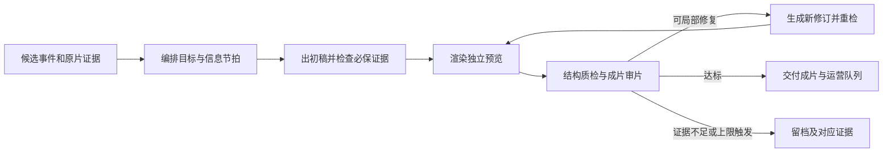

# kiya 切片与编排质量提升实施方案

本文可直接交给三方模型实现。它承接 [kiya 切片流程升级实施任务书](./kiya切片流程升级实施任务书.md)，专门解决候选已经选中之后的成片质量。实现范围包括段内节奏、信息出现顺序、声音层次、手机端画面、实际预览返修，以及把验证结果回流到 Prompt。

## 一、成片要达到什么效果

让第一次观看的人在合适的时刻看懂事件、听清包袱，并记住 kiya 的反应。账号长期希望呈现亲近、可爱、反应真实的虚拟主播形象。选题偏重反差、出丑、抽象和灵机一动，黏人、温馨和自然可爱也有独立价值。编排取舍以当前片段能体现哪一面为依据。

每条成片应当说得清以下四件事。

1. 观众需要知道的第一条信息是什么，在哪里得到。
2. 哪句台词、哪个动作或哪张画面承担变化，观众什么时候意识到它。
3. 哪个原声、表情或结果能完整收尾，为什么保留到这里。
4. 包装提供了什么，手机上是否听得清、看得懂，有没有抢先揭晓或遮住关键画面。

输出允许比较安静、少特效，也允许反应很强、效果密集。各段节奏由叙事需要决定，沿用现有风格档调整力度。

## 二、接手时先核对仓库

先查看当前分支与工作区。旧任务书中的必保证据和待采用草稿可能已由三方部分实现，以下能力列为接续入口。实现前查明它们在 CLI、后台和编辑器里的实际行为，使用独立场次副本和合成样本做基线。

| 环节 | 现有实现入口 | 本轮复用与扩展 |
| --- | --- | --- |
| 原片音画与边界 | [video_evidence.py](../worker/clipper/video_evidence.py)、[rerank.py](../worker/scripts/rerank.py) | 读取事件、局部证据、帧定位和缺口，给段内编排及局部复核提供输入。 |
| 初稿和风格 | [autoedit.py](../worker/scripts/autoedit.py)、[edit_v9.md](../prompts/edit_v9.md)、[variants.py](../worker/clipper/variants.py) | 保留既有风格档。增加叙事重点、信息顺序、可移除区间和效果用途。 |
| 正式稿与独立草稿 | [PendingAiDrafts.vue](../admin/src/components/PendingAiDrafts.vue)、[EditService.java](../backend/src/main/java/com/kiya/admin/service/EditService.java)、[JobService.java](../backend/src/main/java/com/kiya/admin/service/JobService.java) | 现有待采用草稿、版本检查及试渲染是返修的基础。生成、预览、修复和采用各自写到正确版本。 |
| 区间和保护 | [timeline.py](../worker/clipper/timeline.py)、[protection.py](../worker/clipper/protection.py)、[edit.py](../worker/clipper/edit.py)、[cut.py](../worker/scripts/cut.py) | 复用片中删除、必保覆盖和编辑校验。段内删减通过同一套保留逻辑。 |
| 渲染计划 | [render_plan.py](../worker/clipper/render_plan.py)、[render.py](../worker/scripts/render.py)、[Clip.jsx](../renderer/src/Clip.jsx) | 时间映射、镜头和叠层、字幕、声音一起按实际使用的渲染计划检查。 |
| BGM 和镜头状态 | [music.py](../worker/clipper/music.py)、[anim.js](../renderer/src/anim.js) | 已有音乐选择、节拍吸附和对白时压低 BGM。增加对关键原声、短反应和效果出现时机的保护。 |
| 画面和字幕 | [Subtitles.jsx](../renderer/src/components/Subtitles.jsx)、[TextFx.jsx](../renderer/src/components/TextFx.jsx)、[Editor.vue](../admin/src/views/Editor.vue) | 以现有横屏成片在手机宽度下的实际可读性做验收，复用效果和字幕布局。 |
| 质检与反馈 | [quality.py](../worker/clipper/quality.py)、[quality_check.py](../worker/scripts/quality_check.py)、[editdiff.py](../worker/clipper/editdiff.py) | 现有音轨、同步、字幕和效果密度检查继续运行，补预览问题定位、返修记录及样本反馈。 |

记录一份基线。固定候选、源文件、Prompt、模型、剪辑风格和输出分辨率，从精排到实际预览留存证据、脚本、渲染计划、MP4 和质检报告。后续用同一份输入做对照。

## 三、整体工作流



三个角色可以用现有服务和模型组合实现。精排提供事实、候选边界和必保区间。编排决定观众该在什么时候看到或听到什么。审片以实际渲染预览为输入，发现问题后向工作流提出局部改动。程序管理区间、版本、预算、重试和成片状态。

## 四、先定编排目标与信息顺序

### 4.1 每条先选一个主要叙事重点

编排开始前，明确主体、观看预期、关键变化和收束。存在多种看点时，先决定主讲哪一面，并保留理解主线所需的次要信息。

| 看点 | 编排先保留什么 | 常见需要复核的位置 |
| --- | --- | --- |
| 反差 | 能说明初始预期的最短前情，以及后续真实变化 | 开头有没有把结果提前说完，结尾有没有保住变化的最后一拍 |
| 出丑 | 出糗的动作或原话、kiya 的自主反应和找补 | 语气、说话人、互动对象和截止位置是否被误读 |
| 抽象 | 触发语境、离谱原话完整落地、帮助理解的回应 | 花字提前解释包袱，删掉铺垫后让荒诞表达失去语境 |
| 灵机一动 | 原先的题目或困难、她的临场答案、对方有效回应 | 把正常反应画面或另一个问题剪成对这句话的回应 |
| 黏人、温馨和自然可爱 | 说话口吻、对方怎么接、细微停顿与真实反应 | 背景音乐和音效盖住轻声内容，过紧剪法削弱自然感 |

### 4.2 在初稿里给重点时刻排顺序

优先复用精排已有的 beats、证据和边界方案。对会影响编排的节拍提出明确的安排。每个安排包括原片证据、观众在该处需要知道的信息、呈现媒介和效果作用。可以在现有脚本旁以可选元数据保留这份计划，现有编辑字段继续用于实际渲染。

- **开头**交代足以理解触发的最短前情。先导画面可以建立期待，标题或花字在需要悬念的片段避免提前揭晓。
- **核心变化**选原话、关键画面或弹幕中最能交代信息的一项。其他层用于辅助理解，避免同时抢主视线。
- **有效回应和结果**分别标注原声、表情、字幕、结果页的需要保留时长。原声尚未结束时把声音和画面边界分开评估。
- **收束**保留能改变理解的最后一句、重要反应或阅读时间。下一件事单独判断。属于重复的微反应有收短空间。
- **特效**应有具体用途，例如指出结果画面中的词、让观众认出反应主体，或强调已经发生的变化。原片已讲清时保留原构图与原声。

若想用画面先切、原声承接的方式，先检查当前剪辑和渲染能力。现有版本无法准确表示音画分离剪点时，建议可实施的替代手法并标明原片位置。

## 五、段内节奏与删段保护

### 5.1 只针对有证据的可删内容

基于当前事件时间线，定位重复说明、无信息等待、反复确认和可省略的过渡。每个候选删段至少包含原片起止、删段原因、前后相接的证据和潜在损失。判断依据来自原声、画面和字幕，低音量或低帧差仅提供候选。

自动压缩前核对以下条件：

1. 删段前后属于同一个事件，主体、触发和指代能够对上。
2. 被删段内没有必要前情、原声尾部、反应、动作转变、阅读任务或必保证据。
3. 剩余内容还能让首次看的人理解因果。原片存在缺口或归属存疑时，把删段留作建议。
4. 两侧接缝处核对连续帧和声音，检查截断呼吸、掉尾字、音量突然跳变、姿态跳变和字幕断裂。

删段沿用现有 `cuts` 与保护模块。自动营业话清理、段内节奏压缩与人工删除通过同一套检查。模型可以建议时间区间，程序负责核对它和现有必保项的交集。对一次自动生成的整体改动设置合理的修复上限，避免多处删段叠加后丢失语境。

### 5.2 留住情绪节奏

kiya 出糗后愣一下才找补、临场想到答案前的半句犹豫、对方听完后短暂的反应，都可能构成看点。把它们标成与可删等待不同的观察，在后续修复中作为需要核对的时段。缩紧开头时，先检查是否丢掉说话对象和最早可懂的线索。

## 六、原声优先与声音层次

先在实际预览确认对白可懂、反应和环境音有层次，再判断 BGM 与音效要怎么加。保留原素材连续性。区分编辑计划中的音频意图与合成后的真实音轨。

| 问题 | 首选修复 | 验收依据 |
| --- | --- | --- |
| BGM 遮住对白、低声反应或找补 | 在对应区间压低或关闭 BGM，适当平滑进出 | 真实预览能听清关键原话，压低过程自然 |
| 音效抢先提示笑点 | 改到原话或动作出现后，也可移除音效 | 包袱先由人物或原声呈现 |
| 删段后话尾或呼吸突然中断 | 退回原声尾部、调整删段边界，必要时回退该删段 | 原声连续，语义与停顿完整，前后音量变化可接受 |
| 相邻片段声音突然变响或很轻 | 在合法范围内做局部增益和淡变，检查混音输出 | 同源预览对照与本地信号检查，复核真实可懂度 |
| 全片过响、出现削波或音轨缺失 | 检查源轨与混音参数，生成修复草稿后重测 | 最终预览或渲染文件的可测音轨指标 |

沿用现有 BGM `duck` 控制和声音检查，按原声及必保回应区间扩展压低逻辑。音频数值可辅助定位持续过轻、突变和削波。响度目标、可接受范围和手机回听流程先按现有标准或真实样片校准，统一从实际渲染结果测量。

质检报告区分已验证问题、机器提示和待听审问题。无原声或原声归属不明时保留原因及回听位置。突出已有笑声、气息和互动回应，以原片可确认的声音为依据。

## 七、手机端的画面主次和可读性

默认以现有横屏成片缩到手机宽度为主。可沿用项目的 390px 预览尺度作为首轮检查口径。手机截图、短窗预览和最终实际画面相互对照。封面仍以 kiya 为主体，片内关键时刻可优先呈现承担剧情信息的道具、对方反应或结果页。

1. **把主视线说清楚。** 同一时刻是看 kiya 的表情、读字幕、看结果页还是识别弹幕。其余视觉元素避免争抢注意力。画面的情绪冲击和信息阅读冲突时，先确保信息能看清。
2. **核验实际遮挡。** 用渲染后的坐标和时段检查花字、贴图、字幕、运镜彼此是否重叠。关键结果页或人物经放大、平移后的位置应按实际转换计算。位置未知时标疑点并提供复看区间。
3. **分开处理字幕种类。** 二次字幕可以调时间、字体和位置。原画面自带的字要调整保留和画面处理。弹幕优先留下能解释互动的原句。人工校对的字幕以实际套用的修订为准。
4. **检查最短阅读时段。** 在结果出现、缩放变化和过渡动画时核对实际还剩多少可用阅读时间。必要时优先移开遮挡、延长有效画面，或在证据充分时增加简短提示。
5. **避免效果过早或扎堆。** 先识别原片的触发和包袱时间，再核对花字、旁白、音效及卡点。已吸附节拍的效果也要重新检查是否跨到包袱之前。

## 八、用真实预览做一次局部返修

### 8.1 审片顺序

固定草稿修订和渲染计划，先跑结构检查，再以实际 MP4 的画面和声音审片。初轮可以用合成片验证流程，内容效果验收使用独立 kiya 素材。全段已经能回答主要问题时，重点回看首秒、信息变化、删段接缝、关键回应和收束。

审片先回答观众能不能理解，再看体验。发现问题时，输出原片位置、成片位置、影响和最小可行修复。优先级顺序为**事实和语境错误、关键内容损失、可读与可懂问题、节奏取舍、装饰差异**。

以下是问题记录的含义示例。坐标和修订关系须可追溯。

```json
{
  "draft_revision": "example-preview-r1",
  "issue": "essential_response_truncated",
  "source_seconds": [93.54, 100.18],
  "output_seconds": [12.05, 17.21],
  "basis": "rendered_preview_and_source_evidence",
  "evidence_ids": ["AV007"],
  "impact": "观众听到建议但错过主播的完整回应",
  "proposed_change": "把终点延到回应声尾，再检查与下一话题的间隔"
}
```

同一次审片用相同输入可复现。保留模型观察与程序校验的不同来源。版本变更后，上一版发现与当前成片关联时需明确标注修订，避免旧问题被当作新预览结论。

### 8.2 允许自动修复的操作

- 调整花字、贴图和镜头时机，移开遮挡，减少同屏竞争。
- 降低 BGM、移动音效或取消装饰声，修复实际预览里被盖住的关键原声。
- 在已有音画证据支持时补回必保内容、恢复删段或选择已验证的边界方案。
- 修正过短的字幕显示和能明确归因的局部节奏问题。
- 发现标题或旁白把建议写成结果时，收窄到素材支持的说法，同时复核成片语境。

默认完成一次生成和一次针对性返修复查。对于已定位、低风险且当前预算允许的问题，可以通过配置再跑一轮。每轮只改动直接相关的小范围，生成独立修订。复查目标问题是否解决，确认无新的必保损失、误串或事实误写。多轮无改善、需要新证据、出现明显理解分歧或触及预算时，保留较稳的草稿和剩余问题。

### 8.3 草稿、成片与运营的交接

- 每次预览和修复关联候选、证据修订、剪辑脚本修订、渲染参数和成片文件。并发完成的草稿分别留存，采用时按当前编辑修订检查。
- 复用待采用草稿和版本恢复入口。已有人工修改在重生成或自动返修时保留可恢复状态。用户或运营流程采用的是一份明确的草稿修订。
- 同一修订的可复用预览从缓存读取。输出名称或缓存键能够区分局部窗口、分辨率、字幕和效果改动。
- 运营流程读取实际成片的质量结果，普通可修问题自动处理。已确认有必保损失、关键事实仍不确定或存在原片语境风险的稿件留档复核。
- 沿用已确认的运营授权。按北京时间每天最多发布 3 条，已知手动投稿计入。自动运营付费资源每天最多 50 元，新增审片、补证、返修请求及重试纳入同一账目，进行中和费用未知的请求保留预留。日内额度不足时保留产物和续跑位置。

## 九、把质检反馈回到精排与初稿 Prompt

每条有效反馈记录刚才修了什么、证据在哪里、改善前后是什么样。区分开头不足、删段破坏节奏、声尾截断、遮挡、音乐盖住原声、花字提前揭晓、语境误读以及主观风格偏好。

| 重复发生的问题 | 首先改哪一层 |
| --- | --- |
| 总是漏掉结尾的最后有效回应 | 精排补查与边界选择 |
| 证据已标注但初稿总裁掉它 | 初稿边界选择及程序保护 |
| 同类抽象原话总被花字提前解释 | 初稿的信息顺序和效果出场 |
| 轻声互动在预览变得听不清 | 声音编排及实际渲染质检 |
| 观众普遍在同一处才看懂 | 选题、最短必要前情和关键信息层次 |

外部参考视频的持续蒸馏只提出规则候选，记录适用条件、反例、证据和失败回退方式。用独立 kiya 素材对照验证。固定素材、模型和目标，只改对应环节。通过验证的规则按版本进入 Prompt，保留上一版与切换依据。投稿点击、观众理解、留存和人工改稿分别记录，减少把一个爆款错误归因到某一条剪法。

## 十、实现顺序与验收

| 批次 | 实现交付 | 最低验收 |
| --- | --- | --- |
| **第一批** | 初稿标明叙事目标、关键信息时刻和可删区间，接通必保证据保护 | 同一事件能分别产出一份反差主导和一份反应主导的有效编排，另一场素材能保住短笑声及最后回应 |
| **第二批** | 段内删减、原声复核和手机端画面检查 | 自动删除保护声尾、阅读时间与关键反应。真实预览可定位音量跳变、字幕过短和效果遮挡 |
| **第三批** | 预览审片、局部返修及重渲染检查 | 同源预览命中一个已知问题，修复后复测。并发草稿、相同请求重试、预算耗尽和失败恢复都保留正确版本 |
| **第四批** | 反馈汇总、Prompt 对照和多场 kiya 验收 | 报告实际修复效果、误修、人工审核量和调用成本。形成可回看的复测样例 |

### 可直接执行的回归用例

| 用例 | 预期效果 |
| --- | --- |
| 扫码场景只有建议和反应 | 成片清楚说明谁提出建议。标题与画面支持同一层事实。 |
| 跨分窗的延迟回应 | 找得到前后关联，回应完整进入编排。出现新的触发则分开处理。 |
| 出糗后的情绪停顿与重复找词 | 标出可省掉的重复，保留承接情绪的短停顿。删完回听接缝。 |
| 人物表情、原片字幕和叠加花字同时出现 | 手机预览可一眼看出主次。重要文字仍可读，主体表情可看。 |
| 音乐盖住一句低声找补 | 实际预览发现问题，局部降低 BGM 后，原声可听清。 |
| 片中删除与手工字幕重叠 | 成片时间映射使用实际删除区间，字幕重排后不会造成误读。 |
| 删段后发现包袱语气不连贯 | 缩小或撤回删段，生成新修订并验证。 |
| 预览失败或预算不足 | 当前编辑和已有草稿仍可回看，重复请求和用量有账，后续可续跑。 |
| 返修时又发生人工保存 | 草稿独立落盘，采用基于当前修订，人工内容可恢复。 |

从仓库根目录可先运行下列入口验证。运行时使用项目已配置的 Python、JDK 17 和前端依赖。

```text
python -m pytest -q worker/tests/test_protection.py worker/tests/test_video_evidence.py worker/tests/test_edit_timeline.py worker/tests/test_effects.py worker/tests/test_render.py
mvn -f backend/pom.xml -Dtest=EditSpeechTests,EditRecoveryTests test
npm --prefix admin run build
git diff --check
```

涉及镜头、字幕布局、BGM 和预览返修时，再运行实际渲染。以首次观看者能否复述起因、变化和结果为内容验收，以剪点、接缝、遮挡和听感为编排验收。建议初轮用 3–5 场独立 kiya 素材，覆盖反差、出糗、抽象和灵机一动。对照时固定素材、Prompt 以外的变量及输出规格。反馈来自真实观众时记录观看顺序、复述和有时间点的建议。

交付需要包含修改入口、阶段状态、基线对照、验收视频与质检记录、预算和返修次数、暂待复核的问题及回滚方式。优先确认可用场次的真实成片结果。遇到不确定的语境、说话归属或音尾，留下证据区间与复看片段。

## 给三方模型的执行指令

> 接手本任务书后，核对仓库里已经实现的必保证据和独立草稿，以当前代码为起点。按批次依赖完成段内节奏、信息顺序、声音层次、手机端可读性和成片返修。优先复用现有精排、时间映射、草稿、渲染和质检入口。每批直接完成本地验证并保留可回看的产物，使用相同的 kiya 原片和模型对照。普通实现取舍自行处理。需要扩大预算、变更发布授权或覆盖无法恢复的数据时集中提报。形成可复现的草稿、预览、修复记录和成片质量结论。
