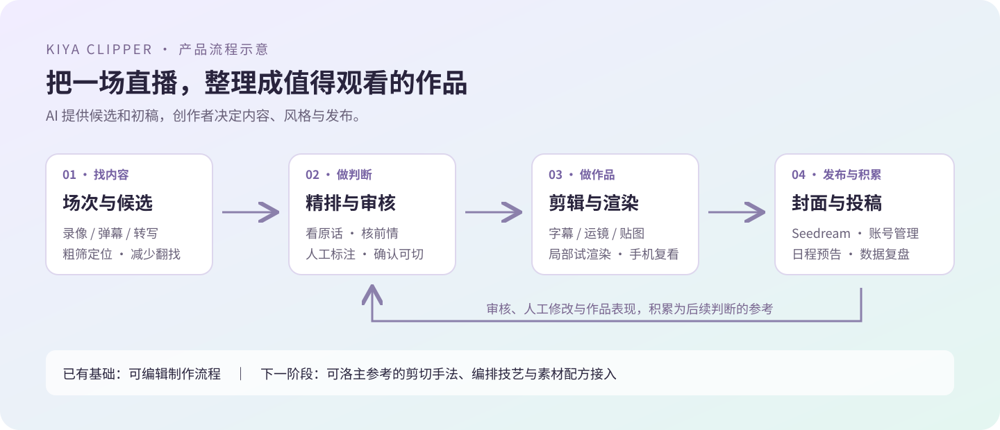
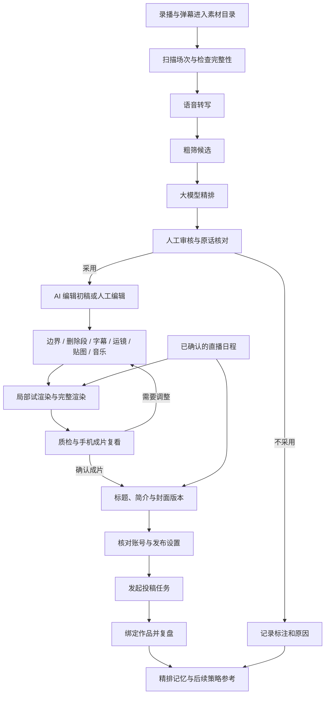
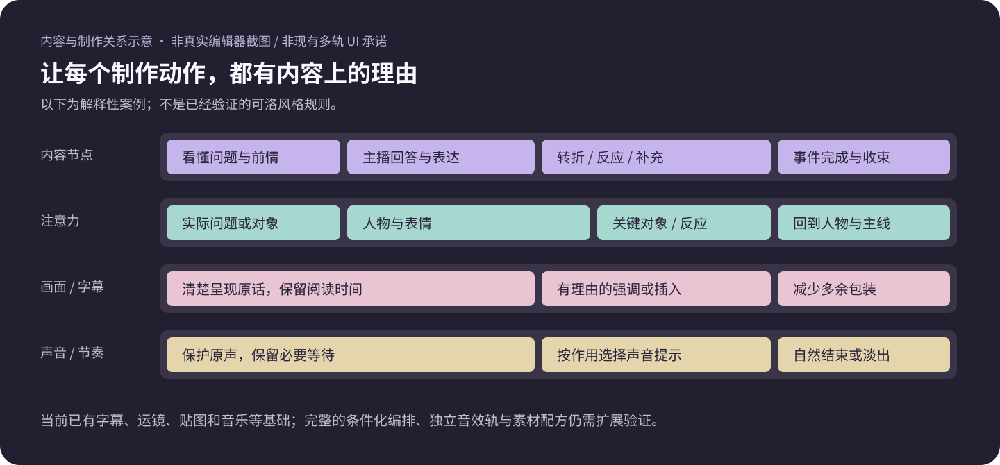
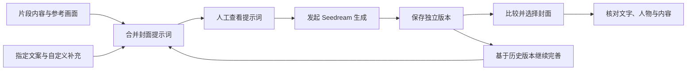
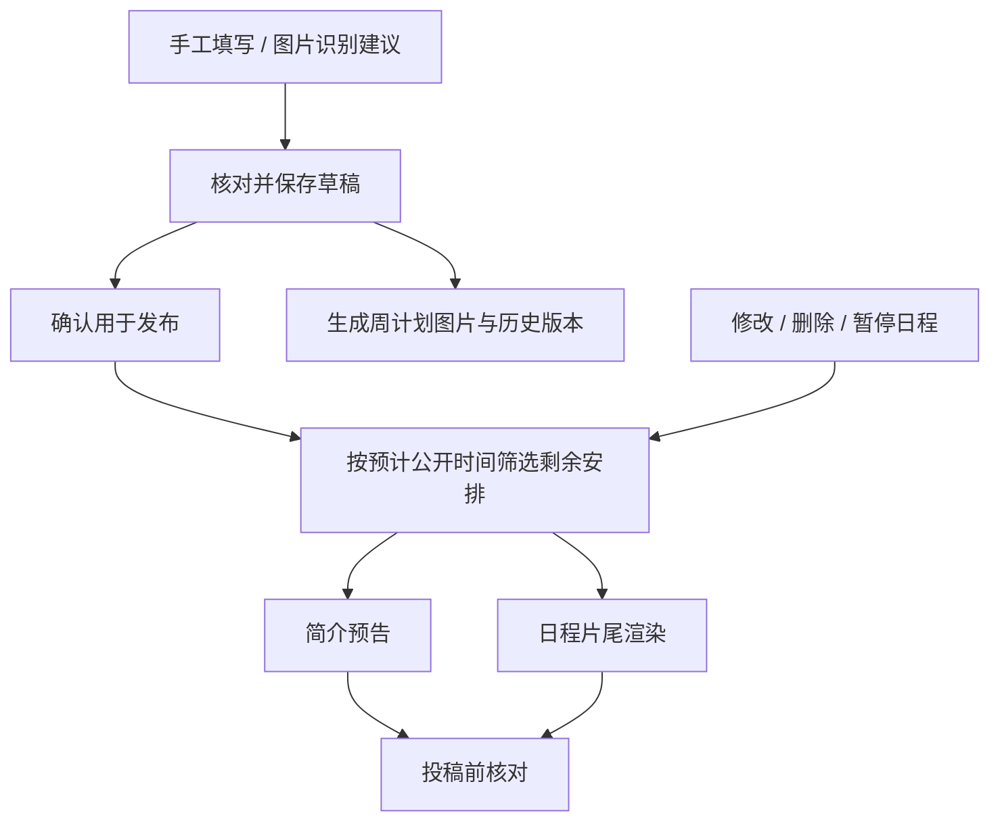
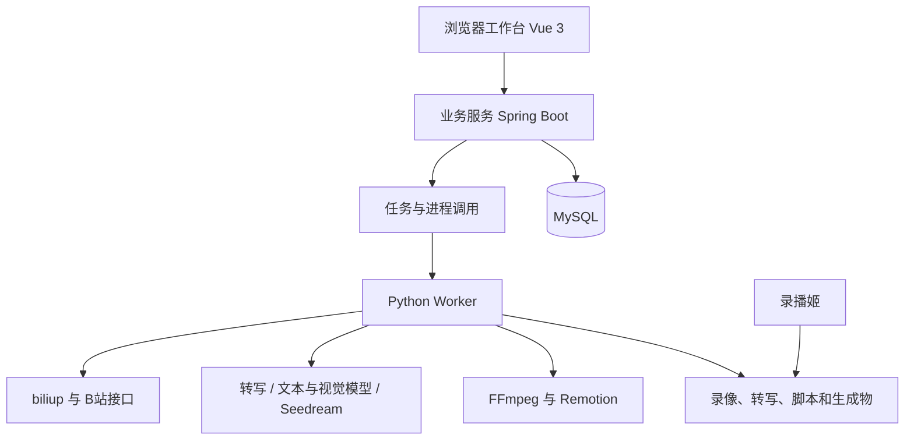

# kiya-clipper 产品介绍

> 面向 VTuber 与直播内容团队的 AI 辅助切片制作工作台。
>
> 从直播场次、候选发现和人工审核，到成片编辑、封面、投稿与日程预告，让直播内容的整理与制作形成可追溯的工作流程。

文档版本：2026-11-18。依据当前仓库代码与功能说明整理，适合主播、剪辑师、运营、合作伙伴及开发团队阅读。本文说明产品能力，不表示所有能力已在服务器更新、所有外部服务已配置或所有流程已通过真实账号验证。

*上图为产品流程示意，不是界面截图。文内“已有实现”表示仓库已有对应实现；“规划”表示仍需开发、接入或样片验证。*

## 目录

1. [产品定位](#1-产品定位)
2. [适用人群与价值](#2-适用人群与价值)
3. [完整使用流程](#3-完整使用流程)
4. [核心功能](#4-核心功能)
5. [以观众体验为中心的制作理念](#5-以观众体验为中心的制作理念)
6. [剪辑师如何使用](#6-剪辑师如何使用)
7. [封面与发布](#7-封面与发布)
8. [直播日程与作品预告](#8-直播日程与作品预告)
9. [记忆、梗库与复盘](#9-记忆梗库与复盘)
10. [多主播与数据管理](#10-多主播与数据管理)
11. [参考风格学习与素材储备](#11-参考风格学习与素材储备)
12. [产品架构与运行条件](#12-产品架构与运行条件)
13. [典型使用场景](#13-典型使用场景)
14. [能力状态与当前边界](#14-能力状态与当前边界)
15. [如何判断产品是否有效](#15-如何判断产品是否有效)
16. [演示与媒体说明](#16-演示与媒体说明)
17. [进一步了解](#17-进一步了解)

## 1. 产品定位

kiya-clipper 将直播录像中的内容发现、剪辑判断、成片制作和发布准备放在同一个工作台里。首位适配主播为娜由纪雅 kiya，系统已具备按主播组织配置、场次、审核、日程与发布账号的基础。

产品的核心目标是：**减少翻找和重复操作，让人把精力投入“这段为什么值得发、怎样剪得更好”**。

它适合持续处理直播素材的个人或小团队。AI 负责发现线索、整理转写、提出候选和生成编辑初稿；主播、剪辑师与运营保留对内容语境、人物表达、制作效果和最终发布的判断。

当前重点是让第一次认识主播的观众也能理解内容，同时保留主播真实的语言、互动和人物特点。面向新观众的内容、传播性内容和老粉共鸣可以并存，具体选题策略由团队决定。

## 2. 适用人群与价值

| 角色 | 关心的问题 | 产品提供的帮助 |
| --- | --- | --- |
| 主播 | 内容是否符合本人表达，哪些话不适合发，如何介绍后续直播 | 禁区与梗管理、人工审核、周报、日程及作品预告 |
| 剪辑师 | 如何找原话、调起止、改字幕、检查效果，怎样减少返工 | 原话定位、逐句试听、片中删除、历史恢复、AI 对照与局部试渲染 |
| 运营 | 哪些候选值得发，标题封面是否对应内容，账号如何管理 | 候选审核、发布包、Seedream 封面版本、发布账号设置及投稿任务 |
| 观众 | 能否看懂事件、读清字幕、感受到主播特点 | 前情提醒、真实引用、手机成片复看与字幕可读性检查 |
| 分析师 / 内容负责人 | 判断是否有效，调整有没有证据 | 审核标注、评测记录、精排对比、精排记忆与有来源的数据复盘 |
| 开发与维护者 | 任务怎样运行、失败如何定位、数据放在哪里 | 任务队列、日志、固定流程编排、配置与按主播组织的数据 |

当前支持按主播区分工作上下文；这不等同于具备完整的多租户 SaaS、角色权限矩阵或在线多人协同剪辑。

## 3. 完整使用流程

*流程图展示功能之间的关系，不表示每次都由一个按钮自动执行。场次页“全流程”的范围是转写、粗筛与剪切；精排、编辑、渲染和发布有各自的操作入口。*

此外，系统提供固定工具链编排入口，串联 `rerank → cut → autoedit → validate → render → quality`，记录阶段状态并支持续跑。该入口不包含自动投稿，也不是可以自行改变工具流程的通用 Agent。

## 4. 核心功能

### 4.1 场次与素材管理

以直播场次为单位查看录像分段、时长、弹幕量和制作进度。场次页集中显示是否已转写、是否已粗筛、候选数量、片段数量、精排状态及审核完成情况。

录像分段缺失会明确提示。弹幕、转写仍可作为内容分析依据，但实际剪切和重新渲染需要相应录像可用。录播获取与切片制作分工明确：录播姬承担录制，工作台读取并处理素材。

### 4.2 候选发现与精排

粗筛利用弹幕、音频和可选画面信号定位候选；语音转写提供可搜索的文本与时间依据。大模型精排结合现有转写、弹幕、截图、主播信息及记忆资料，进一步提出排序和内容判断。

这些信号帮助缩小人工审看的范围，不能把弹幕峰值、大声反应或模型分数直接当作“值得发布”。片段是否有完整事件、是否适合新观众、是否保持原意，仍需要核对。

当前精排并非对原始音频进行完整听音理解。语气、音色和某些声音情绪不能仅从转写或截图得出确定结论。

### 4.3 审核与内容决策

在审核页面播放候选、查看原话、标注是否有趣并添加备注。人工标注既用于当前选片，也为评测和后续精排提供参考。

内容负责人可以将“值得看”和“适合发布”分开判断：一段可能具有反应或笑点，但仍因前情不足、人物表达失真、话题禁区或素材质量问题被放弃。

### 4.4 可编辑的成片制作

系统已有剪辑脚本、可视编辑和渲染流程，支持起止调整、片中删除、字幕修订、字幕样式、花字、放大运镜、贴图和背景音乐等基础制作。

AI 初稿可作为起点，人工可以继续修改。最终效果以真实渲染文件为准；保存脚本不会自动改写之前生成的 MP4。

### 4.5 任务与运行状态

转写、筛选、渲染和投稿等耗时操作通过任务执行，并提供状态与日志。固定流程编排器保存自己的阶段记录，失败后可按其状态续跑。

任务报错应区分输入缺失、外部服务、脚本执行和内容质检问题。上传完成也不等于平台审核通过或作品已经公开。

## 5. 以观众体验为中心的制作理念

### 5.1 先让内容成立

作品应让新观众知道发生了什么、主播在回应谁，以及值得看下去的地方。关键前情、提问对象、转折后的反应和改变原意的澄清都可能是必要内容。

已有“观众体验检查”根据精排资料提示前情依赖、结构不完整、关键原话存疑及开头偏弱等问题，并支持定位证据。提示是复核线索，不是内容正确性的证明。

### 5.2 包装服务于注意力

*图中为解释性案例，说明内容节点、注意力、画面和声音如何对应；不是已上线的多轨编辑器截图，也不是已验证的可洛制作结论。*

近景应帮助看清反应，弹幕特写应帮助理解问题，字幕强调应突出必要信息，声音提示应服务于段落或情绪。制作质量由这些动作是否贴合内容来判断。

### 5.3 保护真实表达与可读性

- 原话、真实弹幕和剪辑添加的评论应可区分；伪聊天 UI 显示“剪辑演绎”。
- 字幕质检提供过短显示、阅读速度和手机字号等启发式提醒。
- 手机成片复看提供窄屏、静音和前三秒播放等检查方式。
- 标题、封面、前情和效果不能编造人物关系、台词或事件结论。

上述检查不能代替实际观看，也不自动保证陌生观众一定看懂。

## 6. 剪辑师如何使用

### 6.1 从一句原话开始修改

编辑器可搜索素材附近原话，逐句试听，使用句子设置起止；必要时扩入前后素材。素材范围与旧预览不一致时会提示重新生成，避免对着错误画面调整。

### 6.2 精修字幕与内容边界

逐句字幕修订仅作用于当前切片，不直接改写整场转写和其他作品。片中删除允许移除不需要的区间，预览与渲染使用相应时间换算，字幕和效果跟随调整。

跨接缝、修订未匹配或录像缺失等情况需要复查。当前能力以已有时间范围与删除区间为基础，不能据此认为任意片段重排、重复引用和复杂多轨混剪都已具备。

### 6.3 减少返工

已有撤销/重做、服务器自动草稿、正式保存历史、版本冲突提示和 AI 原稿对照。剪辑师可以查看自己改了哪些边界、效果和设置，恢复版本后再检查保存。

撤销、草稿与历史各有作用范围；历史记录不是源录像备份。

### 6.4 先试局部，再出完整成片

局部试渲染使用与完整成片一致的组合时间轴，便于检查字幕、动画与声音衔接。默认按钮生成约十秒局部结果，完整成片可按任务设置生成不同分辨率。

已有试渲染不会随编辑自动更新。完成修改后，需要重新生成对应预览或完整成片。

## 7. 封面与发布

### 7.1 Seedream 一体化封面

Seedream 同时设计人物、背景和文字排版，用户可填写封面字、补充构图与色彩要求，也可基于直播画面或已有封面继续设计。程序不再默认叠加固定黄字来完成 Seedream 封面。

生成前可以预览提示词；生成后保留独立历史版本，选择已有版本无需重新生图。模型可能产生错字、漏字或人物偏差，使用前需核对。保存文案设置不会修改已经生成的图片。

### 7.2 发布包

成片编辑页集中准备标题、简介、标签、封面和发布设置。作品可以记录或绑定 BV 号，供后续查询与复盘；重复投稿和绑定冲突应按提示核对，不把失败任务简单等同于未上传。

投稿依赖配置好的 biliup、有效凭证、网络和平台接口。平台风控、审核及公开时间以实际返回与创作中心状态为准。

### 7.3 网站内管理发布账号

配置页面提供扫码、账号密码、短信、浏览器授权和直接 Cookie 登录入口。登录结果需核对昵称与 UID，并确认用于发布，才替换当前主播账号。

账号按主播管理，支持状态检查与停用；有投稿任务排队或上传时限制切换，避免发布到错误账号。五种登录方式的代码与页面已有实现，实际可用性取决于平台风控、人工验证和部署环境，不承诺任何方式始终成功。

后台管理员账号、录播姬账号和 B 站发布账号是不同的登录上下文。

## 8. 直播日程与作品预告

### 8.1 填写与维护周计划

主播可手工填写日程，或上传周计划图片获取识别建议，核对后保存。日程有草稿、已确认和暂停等状态；未确认建议不会直接成为发布预告。

汇总日历支持按周查看、搜索、分类筛选、统计和今天高亮；可以删除单条或整周，空周不继续保留整排日期占位。未填写不等于休息，取消和休息分别处理。

### 8.2 生成周计划图片

支持用 Seedream 参考主播风格生成完整周计划图，保存提示词、日程快照和历史版本；也保留本地排版选项。生成图片应核对日期、时间、标题与人物。

*仓库内已有的风格参考图，展示紫色手账、人物相框与周计划的视觉方向；不是本次生成的最新日程，也不代表当前有效安排。*

### 8.3 同时用于简介和视频片尾

作品可选择介绍预计公开时间所在周的剩余已确认日程。简介追加文字，视频末尾追加日程画面；过去、取消或已结束的安排按规则过滤。

当前日程片尾采用固定七秒的一页布局：少量日程纵排，较多日程扩大区域并分双列，尽量一张图展示完整。日程改变后需要重新渲染，已发布视频不会随数据库变化自动更新。

### 8.4 数据存储

生产日历数据使用 MySQL 保存周记录、草稿和确认版本、图片索引及海报历史元数据；图片文件保留在磁盘。数据库版本控制用于避免并发覆盖，旧 JSON 用于迁移与兼容。

## 9. 记忆、梗库与复盘

### 9.1 精排记忆

精排记忆组织重复出现的说法、审核例子、人工修改及已绑定作品的可获取表现。人工可确认梗、排除误识别、维护禁区，并将确认的说法用于后续资料与热词。

这是已有资料与规则对模型判断的辅助，不等同于持续训练模型权重，也不代表系统已经学会完整的人类剪辑风格。

### 9.2 梗与贴图

当前有梗库及基础贴图素材库，支持图片上传、含义说明和关联。AI 编排使用有含义说明的贴图；网络检索结果的可获取性不代表已经具备发布使用条件。

基础贴图库与下一阶段的综合素材库不同：独立音效、短视频、转场、来源版本、制作配方检索等仍需补齐。

### 9.3 主播周报

周报提供周期内场次、弹幕、精选高光、梗与内容类型等汇总，并支持导出给主播阅读的文档。公开导出与内部审核备注、禁区等资料有不同展示范围。

历史统计周报与未来直播日程是两个模块，避免把“本周发生了什么”和“接下来要播什么”混为一谈。

### 9.4 评测与持续改进

评测以人工标注和补录的漏选片段为依据，比较筛选、精排和不同配置的结果，记录调整内容与评测历史。

作品播放与互动可作复盘参考。没有稿件归因数据时，不计算或承诺真实涨粉转化；缺少曝光数据时，不把播放量解释为点击率。

## 10. 多主播与数据管理

顶部主播选择器切换当前工作上下文，场次、审核、记忆、日程、发布账号等按对应主播组织。新主播通过配置接入，首位主播的旧目录布局保留兼容。

| 数据类型 | 保存方式与用途 |
| --- | --- |
| 主播配置与提示词 | 版本化配置，用于人物资料、识别、排序和制作设置 |
| 录像与转写 | 作为内容依据；录像需按实际保留与归档策略管理 |
| 剪辑脚本与历史 | 保存边界、效果、字幕修改、草稿与版本 |
| 成片、封面及历史 | 磁盘生成物；旧成品不会被文案修改自动重制 |
| 日历业务记录 | 生产环境 MySQL，关联磁盘图片文件 |
| 发布凭证 | 当前主播的服务端凭证文件，接口不向页面返回完整凭证 |
| 任务与评测 | 运行记录、日志和评测数据，用于排错与对比 |

备份需要同时考虑数据库、文件生成物和凭证保护。数据按主播组织不意味着所有数据都已统一落库，也不自动等于权限隔离的完整租户体系。

## 11. 参考风格学习与素材储备

**本节是已制定方案的下一阶段方向，不能当作已上线效果介绍。**

### 11.1 学习目标

以可洛 UID `3494361880856991` 为主参考，另一个账号补充对照，kiya 既有作品用于适配。研究仅纳入十五分钟以内的完整非回放投稿。

重心是视频内容、剪切手法与编排技艺：看点为什么成立，哪些节点必须保留，信息怎样揭示，反应和停顿怎样安排，人物、弹幕和对象怎样交接注意力，以及字幕和声音如何服务内容。

### 11.2 计划形成的成果

| 研究成果 | 后续用途 |
| --- | --- |
| 内容事件模板与必要节点 | 改善候选判断和片段边界 |
| 剪切手法案例与分类目录 | 给出切换、声画衔接、插入、留白等动作的适用依据 |
| 编排技艺案例与节点图 | 明确内容顺序、前后依赖、揭示与收束 |
| 编辑时间线与制作配方 | 把内容目的映射到可执行的画面、字幕和声音动作 |
| kiya 适配与反例 | 区分可借鉴机制、人物依赖和不适合照搬的做法 |
| 素材登记与离线预览 | 准备后续可检索、可追溯、与配方关联的制作素材 |

### 11.3 必要素材储备

按实际配方需要准备音效、贴图、短视频插入、转场、BGM 与 kiya 自有素材，记录用途、来源、使用条件、版本、预览和替代方案。

参考视频里出现的素材先作为研究索引，确认可用于后续制作后再进入候选资产库。素材选择应匹配台词和事件，不按固定间隔随机插入。

### 11.4 从研究到产品的路径

完整事件识别、多种边界比较、任意片段重排、独立音效轨和复杂插入等能力，应按实际代码与样片逐项开发验证。研究完成不会自动带来这些能力。

## 12. 产品架构与运行条件

架构图为主要组件关系示意。具体服务可部署在同一台机器，外部模型和存储按配置使用。

主要条件包括：可用录像、Python 与媒体工具、Node/Remotion 渲染环境、中文字体、业务数据库，以及相应模型和发布凭证。远程账号登录功能需 HTTPS；外部接口是否可达会影响识别、生图、账号验证和投稿。

成本主要来自转写、模型分析、生图、渲染计算及录像存储。实际耗时取决于视频长度、效果、分辨率、机器和外部服务；产品不提供未经测量的统一处理速度或节省比例。

## 13. 典型使用场景

### 场景一：下播后整理值得制作的内容

扫描本场录像，完成转写和粗筛，使用精排缩小审看范围。审核员核对前情和原话，标记采用与放弃，再进入编辑。

**得到的结果：** 有证据、有人确认的候选清单，而不是仅按热度峰值排列的时间点。

### 场景二：剪辑师接手 AI 初稿

搜索关键原话，调整开头和收尾，删除冗余段落，修订字幕，查看 AI 差异。先试渲染关键十秒，再检查完整成片和手机观看效果。

**得到的结果：** 可追溯、可恢复、可继续修改的制作过程。

### 场景三：运营准备一条投稿

核对成片、标题和简介，给 Seedream 补充设计要求，比较已有封面版本；确认发布账号、预计公开时间及日程预告，最后发起投稿任务。

**得到的结果：** 内容、视觉和账号设置集中核对的发布包。

### 场景四：主播更新一周安排

手工填写或上传周表，核对识别结果并确认日程；生成风格化周计划图片。后续作品可带上剩余安排的简介与片尾，修改日程后检查受影响成片并重新渲染。

**得到的结果：** 同一份已确认日程服务于日历、周计划图片和作品预告。

## 14. 能力状态与当前边界

| 能力 | 当前状态 | 应如何理解 |
| --- | --- | --- |
| 场次、转写、粗筛、精排与审核 | 已有实现 | 依赖素材与相应模型；最终选片仍需人工判断 |
| 编辑、字幕、删除段、运镜、贴图与音乐 | 已有基础实现 | 不代表完整专业 NLE 的全部能力 |
| 草稿、历史、AI 对照与局部试渲染 | 已有实现 | 保存与旧视频更新相互独立 |
| 手机复看与字幕质检 | 已有实现 | 规则提醒，不保证内容与混音质量 |
| Seedream 自定义封面和版本选择 | 已有实现 | 生图付费、文字与人物效果需核对 |
| 网站内五种发布账号登录入口 | 已有实现 | 平台验证与真实账号可用性需环境确认 |
| 日历、图片识别、海报历史及日程片尾 | 已有实现 | 日程落库与图片文件需共同维护，旧视频需重渲染 |
| 多主播上下文、精排记忆、周报和评测 | 已有实现 | 不等于完整 SaaS 权限体系或自动增长归因 |
| 固定工具链编排 | 已有实现 | 白名单步骤与状态续跑，不是通用自主制作 Agent |
| 可洛主参考的系统化风格蒸馏 | 执行方案已形成 | 全量研究与适配尚未完成 |
| 综合素材库与制作配方自动调用 | 规划 | 已有基础贴图库，完整资产契约与接入仍需开发 |
| 完整事件重建、多边界比较和复杂重排 | 待开发或扩展验证 | 不能因策略文档已有描述就宣称已具备 |
| 达到参考作者水平或保证增长 | 无验证结论 | 需要实际样片与真实运营数据检验 |

已存在的功能仍需部署和联调。真实发布、账号风控、字体、混音、画面遮挡和素材可用性，应在目标环境中验收。

## 15. 如何判断产品是否有效

建议用同一批素材对比旧流程和新流程，记录具体人工意见，避免只统计生成数量。

| 维度 | 可记录的指标或问题 |
| --- | --- |
| 内容选择 | 送审候选采用情况、漏选事件、放弃原因 |
| 事件完整性 | 新观众能否理解起因、对象、变化和结尾，有无被删坏的必要信息 |
| 剪辑质量 | 进入是否自然、段落是否冗长、反应和澄清是否保留 |
| 制作质量 | 包装是否贴合原话，字幕是否可读，声音是否抢台词 |
| 工作效率 | 找素材、审片、修改和返工的实际用时 |
| 创作者接受度 | kiya 和剪辑师更愿意发布哪个版本，具体改动是什么 |
| 运行稳定性 | 任务成功率、失败原因、恢复成本及外部调用费用 |
| 运营表现 | 同口径的播放与互动；有可信归因时再分析关注转化 |

更合理的阶段目标是生成**更接近可发布状态、修改方向更清楚的初稿**。风格研究、素材丰富度和模型评分本身都不能替代这个目标。

## 16. 演示与媒体说明

本文附带两张可缩放 SVG 示意图、五段 Mermaid 流程图和一张仓库已有的周计划风格参考图。SVG 与参考图片可在支持 Markdown 图片的阅读器中查看；Mermaid 需要阅读器支持相应渲染。

没有附加伪造的界面截图、演示 GIF 或视频。当前未核实到适合直接随介绍发布的产品操作录像，后续可按以下脚本录制，再加入本文：

| 建议演示 | 展示顺序 | 建议时长 |
| --- | --- | --- |
| 从场次找到候选 | 场次进度 → 审核列表 → 播放原话 → 人工标注 | 约 30–60 秒 |
| 精修一条初稿 | 原话搜索 → 起止调整 → 字幕修订 → 局部试渲染 | 约 45–90 秒 |
| 封面版本选择 | 查看补充要求 → 已有封面比较 → 选择版本 | 约 20–40 秒 |
| 日程与作品联动 | 确认日程 → 简介预告 → 七秒片尾 | 约 30–60 秒 |

录制使用演示数据，隐藏凭证与未公开资料；生成等待可加明确时间标记后剪短，不将预制结果冒充即时生成。演示投稿停在可检查的设置或结果页面，避免演示时误发真实作品。

随文资源位于 `docs/product/`。复制或分享本文时，应同时携带该目录；周计划参考另引用 `assets/streamers/kiya/schedule-reference.jpg`。如面向外部发布，应确认这张主播参考图适合对应使用场景。

## 17. 进一步了解

- 使用与部署：项目根目录 `README.md`、`worker/README.md`、`deploy/admin/README.md`。
- 观众体验：`docs/观众体验优化.md`。
- 剪辑工作流与封面：`docs/剪辑师工作流优化.md`。
- 账号管理：`docs/发布账号网页登录.md`。
- 日历与作品预告：`docs/直播日程.md`。
- 多主播接入：`docs/多主播支持.md`。
- 内容目标与判断：`docs/切片内容策略.md`。
- 事件识别规划：`docs/完整事件识别与多边界剪辑方案.md`。
- 风格研究与素材储备任务书：`docs/多账号15分钟内成片风格蒸馏执行方案.md`。
- 系统能力优化规划：`docs/基于参考风格分析的切片系统优化实施方案.md`。
