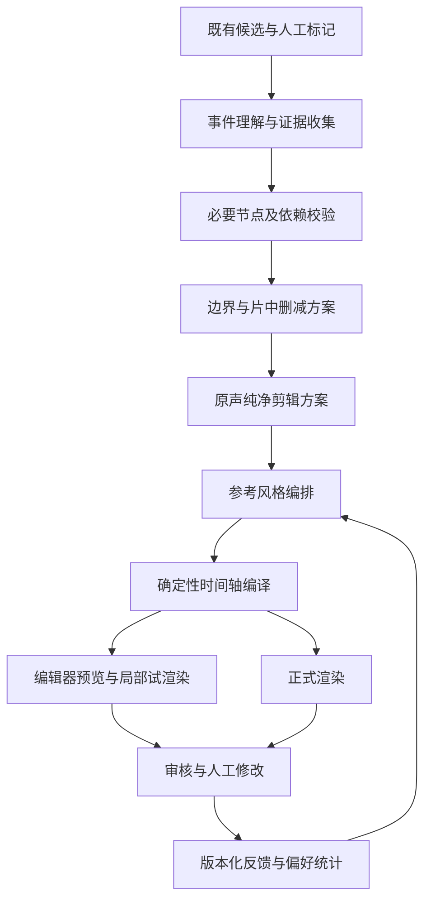

# 基于参考风格分析的切片系统优化实施方案

编写日期：2026-11-18。

状态：**待实施方案**。本文件规定开发范围、数据契约、迁移顺序与验收方式，不表示文中功能已经实现。当前已完成的是参考样本研究及代码现状核对，未完成参考对应原录播对齐、完整听音标注或成片复现验证。

## 1. 要解决的问题与最终交付

当前用户反馈有两个独立问题：

1. 选出的事件与视频范围不合理：可能缺少提问、必要前情、揭示或后续回应，也可能保留了无关等待。
2. 成片风格与参考差距大：人物、弹幕和对象之间的注意力交接不足，包装缺少内容触发，声音与时间轴能力也不完整。

优化后的系统应支持：

**候选发现 → 完整互动理解 → 多种合理切法 → 原声纯净剪辑 → 参考风格编排 → 同时间轴预览与渲染 → 对照审核 → 人工修改反馈。**

第一轮可交付结果应是同一原素材的两版实际视频：

- 原声纯净版：选段完整，完成必要删减和字幕校对。
- 参考风格版：在纯净版叙事结构上加入真实弹幕取景、内容驱动的强调和经过核验的声音。

先证明选段与叙事有效，再判断包装是否接近参考。不能用已经包装的参考成片再次叠效果来冒充复刻，也不以特效数量、生成成功率或提示词长度代替成片质量。

## 2. 依据、已有成果与边界

### 2.1 研究依据

- [首轮样本研究](kiya参考视频风格学习报告.md)：24 条视频，约 38 分 54 秒，按日常互动、自然表达、竖屏、宣传、音乐分组。
- [核心参考逐段分析](kiya核心参考逐段剪辑分析.md)：两条核心追加每秒 5 张采样，整理 56 个编辑状态。
- [首版风格规则](reference_styles/kiya_reference_v1.json)。
- [核心逐段结构化记录](reference_styles/kiya_core_edit_analysis_v2.json)。

两条主参考给出的核心约束：

| 参考发现 | 对系统的要求 |
| --- | --- |
| A 在提问、回答、迟疑、纠正和找补之间推进 | 事件不能只记录一个 punch_time，应记录必要互动节点及依赖关系 |
| B 的视觉对象揭示约在 61 秒，语言解释在约 78–81 秒 | 选段需要找到解释与收束，不把前面的误导表达单独当完整事件 |
| 多次把画面交给真实弹幕，再回人物 | 增加带证据的弹幕取景；伪聊天不能代替真实观众输入 |
| 迟疑、读弹幕和展示对象仍有信息 | 停顿删除必须判断内容目的，不能仅按静音、ASR 字数或时长 |
| X2 / X3 能证明重复强调，不能证明源回放 | 重复呈现与同源回放分开建模，回放必须有源区间 |
| 粉白字幕与黄黑字幕分别存在 | 风格由叙事、取景和视觉语言共同构成，不能只设置颜色或效果密度 |

### 2.2 本方案不作的推断

- 不根据参考成片猜测所有原录播切点、删除内容或重排关系。
- 不把研究中的约秒时间直接用作新素材的剪辑时间。
- 未听音核实的音效、BGM、声线和混音关系保持未知。
- 机器转写与 OCR 只作为辅助证据，不直接充当原话真值。
- 不承诺播放量、涨粉或商业效果提升；本阶段验证剪辑质量与用户风格偏好。

## 3. 当前代码核对：优先修补的断点

以下结论基于编写时工作区，开发前需再核对，避免其他修改造成漂移。

| 项目 | 当前状态 | 影响 | 实施决策 |
| --- | --- | --- | --- |
| 事件时间信息 | `event.py::normalize_event` 输出没有保留 `core_start/core_end/context_start/reaction_end` 等时间字段；边界生成再读取这些字段时使用了回退值 | 下游可能退回候选峰值和固定秒数，而没有真正使用已知事件范围 | P0 修复归一化契约，验证缺失值与未知状态，禁止以峰值冒充已验证核心区间 |
| 事件身份 | `stable_event_id` 的哈希包含候选起止及描述 | 边界改变可能改变身份，与“稳定事件编号”的目标存在冲突 | 持久化分配 canonical event ID，边界只改变 revision，旧 ID 保留 alias |
| 接口传递 | `rerank.py` 写入候选顶层 `event/boundary_options`；`SessionService.rerankByRank` 未将它们加入返回映射；`EditService.get` 随后读取这些键 | 前端存在边界选择入口，但可能没有可用数据 | P0 补齐整个读取链，并加跨层回归用例 |
| 事件识别深度 | 已有结构归一化和简单边界方案；不能据此认为模型已输出完整节点图 | 只有事件概述也可能看起来“有事件分析” | 新增节点、依赖与证据校验，旧结果明确标注 legacy / 未核实 |
| 自动删除 | `edit.py` 和渲染已有 cuts；`autoedit.py::EditOut` 主要为 trim/items/note | 自动初稿没有系统地产生可追溯的片中删除建议 | P1 新增 cut proposal 与 keep reason，复用已有删除实现 |
| 预算与密度 | 默认效果预算 8；推镜有 10 秒硬间隔；贴图数量、重复使用受限；超过预算按时间先后保留 | 后段揭示可能被前段包装挤掉，参考中合理的递进也可能被过滤 | 先做过滤日志与影子评估，再按作用选择；不全局直接放宽 |
| 取景 | 现有 zoom 主要做人物缩放，模板也主要要求对准脸 | 很难表现真实问题、弹幕接话和界面对象 | P3 增加 target 与真实证据卡 |
| 时间轴 | 已有 cuts 压缩、前情和片尾；`render_plan.py` 提供部分规划，`render.py` 仍有独立换算 | 新增插入、回放、声音后容易出现预览与成片不同步 | P2 建立共享编译结果，所有消费端读取同一份映射 |
| 效果类型 | 主要是 text/zoom/sticker/narration/fakeui | 无法直接表达独立背景虚化、暗角、全屏插入等状态 | 分阶段增加类型，不能让模型输出渲染器不认识的效果 |
| 声音 | 主渲染已有源视频音频和可选 BGM，未见独立 SFX cue 编排 | 提示词要求音效不意味着成片实际有对应声音 | P4 增加声音资产、独立轨和试听检查 |
| 字幕与口误 | 已有逐句修订与词级字幕处理 | 通用纠错若改掉真实口误，会破坏事件 | 区分 ASR 纠错、原话口误和编辑评论；保留修订依据 |

**P0 的完成标准是链路真实可用，而不是页面出现了“完整事件”或“三种切法”的名字。**

## 4. 总体结构与责任划分



| 部分 | 负责什么 | 不负责什么 |
| --- | --- | --- |
| 模型 | 理解事件、提出节点、删减和包装建议，说明理由 | 直接写任意路径、执行剪辑命令、宣称没有看过的画面或听感 |
| 证据层 | 原话、弹幕、帧、声音片段与源位置可追溯 | 用抽象标签替代具体证据 |
| 确定性校验与编译层 | 范围、素材、时间、依赖、预算、映射和能力检查 | 凭空补完缺失前情或解释 |
| 编辑器 | 可比较方案、回看依据、手动修改、试听及确认 | 在保存文字时偷偷改写已渲染视频 |
| 渲染器 | 执行编译结果，输出媒体与版本信息 | 独立重新解释事件或重新选择素材 |
| 反馈层 | 记录用户明确采纳、删除及调整 | 把用户“没有修改”一律当作喜欢 |

## 5. 事件理解：先决定“这段究竟是什么”

### 5.1 事件节点

在现有事件概述上增加可选节点：

| 类型 | 作用 | 示例 |
| --- | --- | --- |
| trigger / question | 引起回应的行为、问题或弹幕 | 观众要求辨认英文词 |
| answer / action | 人物回答或行为 | 人物给出对应关系 |
| correction / turn | 改口、反转、误解或变化 | 发现前后回答冲突 |
| reveal / clarification | 对悬念的解释或澄清 | 黄色的对象实际上指向电池 |
| reaction | 人物或观众后续反应 | 迟疑、找补、观众接话 |
| closure | 可以结束的依据 | 解释说完、反应落定、话题自然改变 |

不强迫所有事件使用同一种结构。一句独立表达可以没有 question；没有悬念的素材不必生成 reveal。每个缺省节点应为 `not_required` 或 `unknown`，不能把未发现直接当成不存在。

### 5.2 建议数据契约

以下是**拟新增契约示例**，时间是虚构的整场毫秒，不是参考作品真实源切点：

```json
{
  "schema_version": 2,
  "event_id": "evt_canonical_001",
  "event_revision": 3,
  "streamer_id": "kiya",
  "session": "20261118-2000",
  "kind": "interaction_reveal",
  "summary": "一次观众提问引出的解释与澄清",
  "evidence_revision": "ev-r7",
  "nodes": [
    {"id":"q1","role":"question","t0_ms":112000,"t1_ms":115000,"evidence_ids":["dm-23"],"verification":"verified"},
    {"id":"a1","role":"answer","t0_ms":120000,"t1_ms":124000,"evidence_ids":["speech-41"],"verification":"verified"},
    {"id":"r1","role":"reveal","t0_ms":150000,"t1_ms":153000,"evidence_ids":["speech-52","frame-150500"],"verification":"verified"},
    {"id":"x1","role":"reaction","t0_ms":153000,"t1_ms":156000,"evidence_ids":["speech-53"],"verification":"verified"}
  ],
  "dependencies": [
    {"node_id":"a1","requires":["q1"],"reason":"回答对象否则不明"},
    {"node_id":"r1","requires":["a1"],"reason":"解释承接前面的悬念"}
  ],
  "required_node_ids": ["q1","a1","r1"],
  "closure_node_id": "x1",
  "unresolved": [],
  "status": "ready_for_boundary_review"
}
```

关键规则：

- 模型自报 confidence 与证据 verification 分开，不能由高置信度自动变成 verified。
- 证据状态进一步区分“来源和时间机械匹配通过”与“含义已经审核”。找到同一句原文只能证明引用存在，不能自动证明事件解释正确；保存 verifier、方法、时间与输入 revision。
- 必要节点由理解依赖决定，不由“是不是笑点”决定。
- 验证原话是否落在已读转写内，画面描述是否来自实际提供的帧，弹幕是否来自对应场次与时间。
- 没有声音输入时，不输出“温柔声线”“尖叫”“嘲讽语气”等已核实标签。
- 节点可以引用多个媒体证据；纯弹幕不能证明人物实际做过某个动作。
- 不完整事件进入待复核，保留可回看的依据；不得静默补写一张解释字幕后声明完整。

### 5.3 上下文扩展

复用现有粗筛和精排结果，围绕缺口增量读取：

1. 先读取已有候选范围、前后文、关键帧和弹幕。
2. 若出现明确问题，例如回答对象缺失、悬念未解释、代词不明，记录缺口。
3. 沿缺口方向扩展读取，再补证据，不对每个候选默认读取整场。
4. 仍缺资料、源录像缺段或达到素材上限时进入待复核。

当前编辑素材上限为 500 秒，配置中的精排最长成片范围为 480 秒。第一阶段保持这些上限，超出不能通过强行裁短让方案“校验通过”。以后要扩展上限，需同时核对 Python、后端、编辑器和渲染资源消耗。

### 5.4 事件身份与重复

- canonical ID 首次建档时持久化分配；rank、摘要、边界和推荐切法变化只增加 revision。
- 相邻或重叠候选仅用于检索可能重复事件，再依据核心行为、对象和证据判定。
- 合并使用 canonical ID 与 alias，保留所有来源；拆分记录父子关系和人工原因。
- 已有发布绑定、历史 event_id、BV 号关联保持可查询，不因重新排序或新哈希断开。
- 跨主播必须隔离。不能仅凭“突然笑了”等相似文案合并事件。

## 6. 选段与片中删减：先产出能看的纯净版

### 6.1 三种切法的正确含义

| 切法 | 优化目标 | 不能省掉的内容 |
| --- | --- | --- |
| 精简版 | 压缩重复表达、无关等待，尽快进入有效互动 | 所有必要节点、正确回答对象、必要揭示 |
| 完整语境版 | 让新观众自然理解前因与对象 | 问题、关键前情、解释与收束 |
| 保留反应版 | 保留有价值的迟疑、笑、找补与观众反馈 | 主体事件及能证明反应价值的内容 |

三版可以相同，也可以只有一版成立。不得为了展示三个按钮制造三段不同但不完整的范围。没有必要节点证据时，旧 refined 可作为“旧建议”展示，不能标成已验证的新方案。

### 6.2 从固定秒数改为节点约束

方案必须覆盖全部 required nodes，以及其必要依赖；结束至少覆盖有效 closure 或明确说明结束点待确认。

- 不能仅用“峰值前两秒、后三秒”代表精简版。
- 不能只验证核心点在范围内，就认为提问和揭示均已覆盖。
- 允许用真实弹幕卡补充同一事件的输入，但必须有证据与阅读时间；这不是任意压缩必要前情的通用许可。
- 加入前情文字时，保留其来源和作用，避免提前剧透或改写人物意思。

### 6.3 删除建议与保留理由

新增 `cut_proposals` 和 `keep_spans`，先作为建议保存：

```json
{
  "cut_proposals": [
    {"id":"cut-1","t0_ms":125000,"t1_ms":149000,"reason":"已核对为无关等待","evidence_ids":["review-8"],"verification":"human_verified","enabled":true}
  ],
  "keep_spans": [
    {"t0_ms":112000,"t1_ms":115000,"reason":"观众需要读清真实问题","node_id":"q1"},
    {"t0_ms":150000,"t1_ms":153000,"reason":"必要揭示","node_id":"r1"}
  ]
}
```

上例的“无关等待”是示意的人审结论，不是由静音长度推出来的标签。未确认的建议不默认执行长区间删除。

自动执行前检查：

1. 不与必要节点、受保护原话或人工保留区间重叠。
2. 不切断同一句话、对象名称、笑声尾音或语义连接。
3. 删除后相邻句是否仍能自然承接，音画是否存在突兀跳变。
4. 重复表达是否承担升级、确认或嘴硬作用；不能见重复就删。
5. 字幕缺失、ASR 低置信或自动营业话分类不明时不静默删除。
6. 所有自动删除、人工恢复与拒绝原因可追溯。

复用 `timeline.py` 与已有 `cuts`，第一版不重写切片编码链。先打通“建议—预览—确认—渲染”的闭环，再扩大自动执行范围。

## 7. 统一时间轴：为插入、回放和声音打基础

### 7.1 三层时间分开

| 时间层 | 单位与用途 |
| --- | --- |
| SourceTime | 整场毫秒，定位原话、帧、弹幕、素材区间 |
| SequenceTime | 源区间在成片中的组织，包含删除后拼接，未来支持重复或插入 |
| OutputTime | 成片毫秒及最终帧号，驱动包装与声音 |

持久化事件与素材位置优先使用整数毫秒；媒体保留原 time base / fps 有理数。只在编译时转换成输出帧与音频采样位置，累计端点统一舍入，避免每段分别舍入产生漂移。

### 7.2 先兼容 version 1，再引入 version 2

1. `trim + cuts + callback + schedule` 由适配器编译为统一 plan，不立即改写已有人工脚本。
2. 编辑器、局部试渲染、正式渲染和质检统一消费同一份 compiled plan。
3. plan 通过回归后，才开放包含重排、回放和插入的新脚本 version 2。
4. version 2 不能静默退化保存为 version 1，否则会丢失序列语义。旧服务读取不支持版本时明确报错。

### 7.3 version 2 序列示意

同样使用虚构源时间，以下只说明映射，不是参考片复原结果：

```json
{
  "version": 2,
  "sequence": [
    {"id":"seg-a","kind":"source","session":"20261118-2000","t0_ms":111000,"t1_ms":125000,"role":"question_and_answer"},
    {"id":"seg-b","kind":"source","session":"20261118-2000","t0_ms":149000,"t1_ms":157000,"role":"reveal_and_reaction"}
  ]
}
```

编译结果：

| 序列项 | 源区间 | 成片区间 |
| --- | --- | --- |
| seg-a | 111–125 秒 | 0–14 秒 |
| seg-b | 149–157 秒 | 14–22 秒 |

后续若经确认添加一次 120–124 秒回放，应创建新的 sequence item，如 seg-c，映射到成片 22–26 秒。相同源时间此时有多个成片位置，不能再使用单值 compact_time 代表全部映射。

### 7.4 包装锚点与映射规则

- 包装与音效绑定 `sequence_item_id + offset_ms` 或已验证的事件节点，由编译器解析到 OutputTime。
- 同一源话语回放时，默认不复制所有包装；每次 occurrence 明确决定字幕、评论、音效是否复用。
- 跨删除区间的效果不能无条件把前后时长合并。根据类型选择裁短、拆段、保持成片连续显示或拒绝，记录策略。
- 人物取景、字幕、弹幕卡、SFX、BGM、前情和日程片尾均需进入同一 plan。
- 局部预览只是完整 plan 的视窗，不能独立重算节奏、BGM 或事件边界。
- 静止一帧、源视频回放和外部反应插入分别建模；第一版不默认增加变速、倒放或复杂跨场次拼接。

## 8. 风格系统：参考方向与强度分开

### 8.1 两条主方向

| 风格 | 适用素材 | 主要手法 | 不适用时的处理 |
| --- | --- | --- | --- |
| 互动考题—反应递进 | 有真实提问、回答、纠正与反应 | 先看题，再看人物；保留有价值迟疑；短评论与递进强调；回人物收尾 | 缺问题则补检索或待复核，不编一个问题 |
| 误导设题—揭示澄清 | 素材原有双关或悬念，并能找到解释 | 分步语义包装、观众接话、对象揭示、澄清与短尾梗 | 无揭示则不自动使用该结构 |

自然表达、音乐、宣传和竖屏继续分开，不能用一个“热闹”参数覆盖全部作品。

### 8.2 风格配置内容

建议新增经确认的运行时风格配置；研究 JSON 不直接当生产配置加载。

配置至少包括：

- profile_id、version、streamer_id、适用事件与排除条件。
- 叙事节点偏好与不可省略约束。
- 人物、弹幕与对象的取景规则。
- 原话字幕、真实弹幕、编辑评论的视觉区分。
- 背景处理、语义强调、全屏插入和声音使用条件。
- 可用资产集合、能力要求、预算与降级方式。
- 已核实参考证据、待核实声音项、用户反馈来源。

“克制/标准/热闹”作为该方向内的强度选择，不改变事件必要节点。低强度也必须保留问题和揭示，高强度也不能制造台词。

### 8.3 模型编排方式

推荐分两次决策，并缓存中间结果：

1. **结构编辑**：只提出边界、删除、保留停顿、必要节点和顺序。得到纯净版。
2. **风格编辑**：在已经确定的结构上提出取景、字幕强调、图形和声音建议。

结构编辑失败时不继续包装；风格编辑失败时保留可看的纯净版。不要一次调用同时猜源时间、理解事件、选素材、造字幕和编效果，然后只检查 JSON 能否解析。

## 9. 取景与真实弹幕：第一批新增画面能力

### 9.1 从 scale/x/y 升级为取景意图

新增 target 表达：`subject`、`danmaku`、`object`、`full_frame`。每次取景说明目标、证据、进入方式和恢复位置。

- 对人物：定位实际脸部或身体区域，保留关键动作，不能假定所有主播始终在画面右下。
- 对弹幕：从原 XML / 事件或原画面取得内容，校准已有弹幕延迟；OCR 与用户名不确定时回看确认。
- 对对象：保留真实界面或物体证据，不让模型画一个看似相同的“官方界面”。

第一版允许人工框选并保存静态区域；后续再做目标跟踪。没有可靠区域时退回全景或人工定位，不随机推近。

### 9.2 focus_card 拟新增契约

以下坐标为虚构归一化示意，不是参考视频中的真实框：

```json
{
  "type": "focus_card",
  "anchor": {"sequence_item_id":"seg-a","offset_ms":1500},
  "duration_ms":1800,
  "evidence_id":"dm-23",
  "source_frame": {"session":"20261118-2000","time_ms":112500},
  "region": {"x":0.02,"y":0.22,"width":0.36,"height":0.20},
  "background": {"mode":"blur"},
  "restore_target":"subject"
}
```

卡片类型必须区别：

| 类型 | 内容来源 | 展示要求 |
| --- | --- | --- |
| 真实截图卡 | 可追溯源帧与区域 | 保持原内容，不无痕改字 |
| 真实弹幕文字卡 | 已验证弹幕事件 | 标注为弹幕摘录，不伪装原始截图 |
| 编辑评论卡 | 编辑创作 | 明显区别于原话与真实观众输入 |

### 9.3 阅读时间与遮挡

- 以可读字数、字号与缩略图预览决定停留，首版可用“至少 1 秒、按约 6 字/秒估算”作为待验证初值，不宣称来自这两条样本的测量。
- 过长时分卡、保留更长阅读或进入人工调整，不以固定上限强行截断真实文字。
- 同时检查人物脸部、底部字幕、其他关键信息是否被遮挡。
- 显示完成后明确回人物或全景，避免卡片持续遮住后续回应。

## 10. 视觉包装与预算调整

### 10.1 分层编排

| 层 | 示例 | 管理方式 |
| --- | --- | --- |
| 基础画面 | 源视频、人物或弹幕取景 | 由 camera/sequence 控制 |
| 背景状态 | 暗角、局部虚化、色调 | 可持续，但必须有起止和恢复 |
| 语义强调 | 问号、加载、金币、指示手势、短评论 | 与具体节点绑定，避免相互争抢 |
| 信息层 | 原话字幕、真实弹幕卡 | 可读性与证据优先 |
| 插入层 | 全屏反应、同源回放 | 有独立源与时间映射、明确音频策略 |

### 10.2 预算选取

先生成带 `purpose/priority/node_id` 的建议，再按以下顺序取舍：

1. 必要问题与对象信息。
2. 揭示、纠正与关键反应。
3. 帮助理解的强调。
4. 可选装饰与尾梗。

保留画面负担限制，但不继续简单使用 `items[:max_items]`。同时检查语义层重叠、脸部遮挡、文字竞争、相邻取景衔接和长时间持续强效果。

### 10.3 逐步替换现有硬规则

- version 1 旧脚本继续沿用原校验，避免历史视频突然改变。
- 新 profile 在影子模式记录“原规则会删哪些建议、语义规则会保留哪些建议”，先比较再启用。
- 推镜 10 秒间隔不直接全局删除。按 camera 句法区分硬切取景、持续近景、短强调与独立推镜；有理由的连续递进才允许例外。
- 贴图同类回扣可以重复，但需满足语义回扣、时间间隔和画面恢复，不能无限重复。
- 背景处理不与一次短评论简单等价计数，但仍有独立的强度与遮挡限制。
- 每个被拒绝、裁短、替换或缺资产的效果写入 `dropped_items`，包括原因与发生阶段。

### 10.4 全屏反应与回放

先实现一种经过确认的短全屏插入，再扩展素材选择与回放。记录资产来源、入出点、纵横比、音频是否使用、淡入淡出和与原话关系。

不能凭参考中的领奖台或影视画面，直接假设系统有可用的同款资产。未准备资源时省略，不能返回不存在的路径。回放尤其需要真实源区间；没有对齐不能根据 X2 / X3 自动生成。

## 11. 字幕与原话：保住内容价值

字幕分三条逻辑轨：

1. 原话转写及经核对的 ASR 修订。
2. 真实弹幕摘录。
3. 编辑评论、解释或强调文字。

复用 `speech_edit.py` 的按原句时间与原文绑定修订，不改写整场转写来适配一条切片。

新增修订原因：`asr_error`、`proper_name`、`punctuation`、`preserve_spoken_mistake`。人物实际说错的答案保留，不能因通用纠错自动变成正确答案。关键英文或口误置信不足时提示回听，不能生成高置信的假字幕。

若手动改字导致原词级时间不再可靠，继续采用当前“退回句级显示”的原则；有词级对齐服务时重新对齐，而不是均分时间伪装精确。

包装文字可跟随语义重音，但不强制全部逐字跳动。发布前检查全文、错字、重复、遮挡及主体裁剪后的可读性。

## 12. 声音系统：先可听清，再学习具体音效

### 12.1 先补参考听音标注

按详细报告中的待核验表标注两条核心：声音来源、是否保留原声、效果进入退出、是否有空隙、与词句/画面关系。机器能量曲线不能自动给音效命名。

未核实声音项保持 unknown，不将“画面有金币”自动转换为“原片使用了金币音效”。

### 12.2 声音轨契约

- 原声音轨：默认保留；原声压低、静音或替换均有明确区间与理由。
- SFX 轨：引用资源库 asset_id，绑定已验证节点或序列锚点。
- BGM 轨：曲目可用性、起点、循环、淡入淡出和人声避让独立配置。
- 插入视频声音：明确用原声、保留主体声、静音或混合，不双重播放。
- 品牌与日程片尾：独立音频策略，不能漏掉或覆盖主体最后一句。

候选 SFX 数据示意：

```json
{
  "asset_id":"sfx-approved-014",
  "anchor":{"sequence_item_id":"seg-b","offset_ms":1000},
  "purpose":"揭示强调",
  "gain_db":-6,
  "fade_in_ms":20,
  "fade_out_ms":80,
  "allow_overlap_speech":false
}
```

数值只是拟定测试输入，不是从参考测得的配方。实际增益需要结合资产本身音量和听音验证，不能给所有文件固定同一增益。

### 12.3 渲染与验收

Remotion 与 FFmpeg 选择一个作为音频时序的主执行方，避免两端重复混音。无论谁执行，均由 compiled plan 确定时间。

需要检查：关键原话可辨、突发音效不会盖住词句、峰值不溢出、插入片段不突然巨响、字幕关闭时不误判“无人说话”而抬高 BGM、片尾音频没有提前结束或重复。

初版提供原声 / SFX / BGM 的独听、静音与对照播放。音量曲线和信号检查辅助发现问题，最终风格匹配仍需实际听音。

## 13. 编辑器工作流

在现有 Editor 内增量增加面板，不先重做一套剪辑软件。

### 13.1 事件与选段

- 显示事件概述、必要节点、证据、未解决问题和结束依据。
- 点击节点可回看原素材，展示整场时间和当前成片位置。
- 并排比较精简 / 完整语境 / 保留反应，明确每版省略与保留的内容。
- 删除区间显示理由，保留停顿显示其作用；支持逐条启用、恢复和人工覆盖。

### 13.2 风格与编排

- “参考方向”和“效果强度”分开选择。
- 显示这条素材为何适合某方向，缺少节点时说明原因。
- 可切换纯净版与风格版，同步播放到相同的源事件节点。
- 查看模型建议与程序最终保留结果，尤其显示预算、资产和能力过滤。

### 13.3 时间轴与音频

- 同时显示源时间、成片时间和片段 occurrence，避免回放时误跳第一次出现。
- 人物、弹幕卡、文字、背景处理和声音分层开关。
- 局部试渲染使用完整 plan；提示这是某一 revision 的结果。
- 保存草稿沿用现有 revision 冲突检查与恢复机制，切换版本前不覆盖人工未保存修改。

产品文案优先使用“问题没交代”“解释缺失”“这段保留看反应”“音效盖住原话”等可理解表述，技术字段只在详情中展示。

## 14. 接口、文件与版本设计

以下均为拟新增或扩展，不代表接口已存在。

### 14.1 优先复用的文件布局

```text
output/<streamer>/<session>/
  events/<event_id>/<revision>.json
  evidence/<evidence_revision>/manifest.json
  edit_plans/<rank>/<plan_revision>.json
  render_plans/<rank>/<render_hash>.json
  edits/<rank>.json                 # 当前已确认人工脚本，沿用既有规则
  edits/<rank>.ai.json              # 已有 AI 初稿保留
  render_previews/                  # 已有预览机制扩展版本元数据
  final/                           # 已有成片
  quality/                         # 已有质检报告扩展
```

沿用现有多主播与旧目录兼容规则，不硬编码新的 output 根目录。新 revision 文件不可变，当前指针使用原子更新和乐观锁；避免新增另一套会相互覆盖的“最终真相”。

作业继续使用现有 JobService、状态与取消机制。第一阶段无需引入新消息队列、向量数据库或模型训练平台。若后续需网站维护风格库，可在现有数据库增加索引和权限元数据，文件内容仍须有明确唯一权威来源。

### 14.2 接口建议

| 接口 | 用途 | 修改约束 |
| --- | --- | --- |
| 现有编辑初始化接口扩展 | 返回 event、boundary_options、证据状态、profile 与 plan revision | 保持旧字段兼容 |
| `GET /api/sessions/{name}/events/{eventId}` | 读取事件与必要节点 | 当前主播隔离 |
| `PUT /api/sessions/{name}/events/{eventId}` | 人工修订事件 | expectedRevision 必填，冲突返回 409 |
| `POST /api/sessions/{name}/events/{eventId}/analyze` | 异步补充事件理解 | 返回作业 ID，携带预期输入 revision |
| `POST /api/sessions/{name}/edits/{rank}/plan` | 生成结构或风格候选方案 | 不直接替换人工脚本 |
| `POST /api/sessions/{name}/edits/{rank}/plan/accept` | 将选中方案设为当前编辑版本 | 核对 plan 与当前证据 revision |
| 现有 `preview-plan` 扩展 | 返回共用 compiled plan 摘要与警告 | 不调用模型、不编码完整视频 |
| `GET /api/reference-styles` | 读取已确认可用的风格与能力 | 区分研究草稿、影子与已启用版本 |

状态修改继续沿用现有会话认证、CSRF 和主播隔离。服务端解析资产 ID 与受控路径，模型输出不能直接指定任意磁盘路径、外部地址或执行参数。

### 14.3 失效与缓存

render hash 至少覆盖：源媒体指纹、事件 revision、证据 revision、编辑脚本、风格版本、字幕修订、资源内容哈希、音频参数、片尾快照、编译器与渲染器版本。

- 改边界或删除区间：所有对应字幕、包装、音频映射失效并重新编译。
- 改风格：保留已确认结构，重做包装建议与对应渲染。
- 改一句字幕：更新字幕和受影响的编译结果，不必重跑整场理解。
- 修改日程：新渲染采用新快照；已有媒体保留生成时快照和版本，不宣称文件已自动更新。
- 异步任务结束前再次比较输入 revision，过期结果保存为历史，不覆盖更新的人工版本。
- 各阶段缓存键包含主播、场次和内容指纹；不能仅按 rank 缓存。

## 15. 资源与计算预算

### 15.1 分层处理

1. 粗筛沿用现有流程，增加候选证据来源，不对全场默认逐帧识别。
2. 对计划精排的候选，先使用已有逐字稿、弹幕与稀疏帧。
3. 仅在必要节点或动作缺失处追加短片段观察和音频信息。
4. 先确认结构，再对少量已通过事件生成风格候选。
5. 先低清局部试渲染，通过后再正式编码。

### 15.2 预算配置

至少提供每事件上下文扩展轮数、最大补充帧数、音频分析秒数、模型调用上限、失败重试上限、每批候选数量、同时生成版本数和渲染并发限制。

具体数值先通过一批原录播测量再定；本方案不凭样本数量虚构成本预测。达到预算返回“资料不足/预算达到上限”，不能默认 complete=true。

参考作品只需在 profile 新建或版本变化时分析。不能每次生成一条新切片都重新上传或重看 24 条参考。

## 16. 开发阶段与实施包

| 阶段 | 实施包 | 主要交付 | 进入下一阶段的条件 |
| --- | --- | --- | --- |
| P0 | 已有事件链路修复与可观察性 | 时间字段保留、事件/边界接口传递、旧结果标记、过滤日志 | 构造数据端到端在编辑器可见，真实范围没有被回退值覆盖 |
| P1 | 完整互动与纯净剪辑 | 事件节点、必要依赖、上下文补检、边界与删除建议、原话保护 | 人工核验的原素材能产出完整、无错切的纯净版 |
| P2 | 统一时间轴编译 | version 1 适配、共享 plan、字幕/效果/前情/片尾映射、revision/hash | 预览与正式渲染在时间及内容上通过回归 |
| P3 | 第一条参考风格闭环 | 已确认 profile、真实弹幕卡、target camera、分层预算、可比较样片 | 同一原素材的风格版可实际渲染并经用户具体反馈 |
| P4 | 声音与高级画面 | 参考听音标注、SFX 轨、混音控制、全屏插入；随后才开放确认后的同源回放 | 实际听音通过，重复/插入映射正确，缺资产能可靠降级 |
| P5 | 反馈与有限自动化 | 按风格记录采纳与修改，离线评估、小范围启用 | 留出样本优于旧基线且没有完整性和证据回退 |

P1 可先复用现有 cuts 渲染验证纯净版；P2 稳定后再进入新类型的生产渲染，避免等待全部架构完成才看到选段改善。P0–P3 是首个可交付迭代，不把全部目标捆成一次大重写。

### P0 任务清单

- [ ] 明确 `normalize_event` 可保留字段、类型、未知值及 revision 契约。
- [ ] 保留核心、前情与反应真实时间；缺失时明确 unknown。
- [ ] 补齐 `rerank.py → SessionService → EditService → Editor` 的事件与边界传递。
- [ ] 防止旧 rerank 与新 candidates 错配；继续保留粗筛重跑后的失效检查。
- [ ] 建立事件 canonical ID 与旧 ID 兼容策略，避免直接重写已有发布关联。
- [ ] 对模型建议、校验拒绝、密度过滤、预算截断分别记日志。

### P1–P3 首迭代任务清单

- [ ] 增加事件节点与依赖的模型输出和确定性校验。
- [ ] 将完整性从一个布尔值改为可解释节点状态，旧字段仍返回兼容摘要。
- [ ] 结构初稿输出 cut proposals、keep spans 和理由；先不自动接受低证据删除。
- [ ] 让候选边界、字幕、片中删减使用一致的源时间定义。
- [ ] 用现有原句修订保护真实口误与重要专名。
- [ ] version 1 先编译为共用 plan，逐个替换重复映射逻辑。
- [ ] 增加真实弹幕证据卡及人工区域框选，先支持静态框。
- [ ] 新 profile 按语义选择预算，保留 legacy 校验用于旧脚本。
- [ ] 编辑器提供纯净 / 风格对照与过滤原因。
- [ ] 至少完成一条真实原录播样片，记录用户逐项修改。

## 17. 代码改动地图

下表的“新增”是建议模块名，开发时可调整，不表示文件已经存在。

| 文件 / 模块 | 计划变更 |
| --- | --- |
| `worker/clipper/event.py` | 修复字段保留，增加节点/依赖/完整性校验，事件身份与边界方案 |
| `worker/scripts/rerank.py`、新事件理解提示词 | 事件输出接入、证据扩展、旧结果兼容，不能只在末尾补一个归一化概述 |
| `worker/scripts/autoedit.py` | 分结构与风格阶段，新增删除建议、keep spans、profile 与能力约束 |
| `worker/clipper/edit.py`、`schema/edit_script.schema.json` | 明确新旧契约、可识别类型、原子保存与未知字段处理 |
| `worker/clipper/timeline.py`、`render_plan.py` | version 1 适配与确定性编译；未来一对多 occurrence 映射 |
| 新增 `editorial_plan.py` / `reference_style.py` | 方案验证、风格适用条件、分层预算、过滤记录 |
| `worker/scripts/render.py`、`renderer/src/Clip.jsx` | 统一消费 plan，新增目标取景、focus card、背景处理与音频 cue |
| `renderer/src/anim.js` 与新组件 | 将取景切换、持续镜头和短强调分别实现；新卡片、处理、音效组件 |
| `worker/clipper/subtitles.py`、`speech_edit.py` | 多轨语义、口误保护、修订失效与再对齐，不静默编造词级时间 |
| `worker/clipper/quality.py` | 完整性、证据、遮挡、错位、声音与缺资产检查 |
| `worker/clipper/editdiff.py` | 从简单 items 差异扩展为结构、删减、取景、声音和理由差异 |
| `backend/.../SessionService.java`、`EditService.java`、`EditController.java` | 补元数据、revision、作业入口、方案确认与 plan 摘要 |
| `admin/src/views/Editor.vue` | 事件、边界、删除建议、参考方向、轨道、对照和试听入口 |
| `config/kiya.yaml` 与主播模板 | 增加 profile、能力与预算配置；新功能初始关闭或影子运行 |

## 18. 测试与验收矩阵

### 18.1 必须补的功能回归

| 测试 | 输入与预期 |
| --- | --- |
| 时间字段不丢失 | 归一化前后 core/context/reaction 时间精确保留；缺失值不变成已验证峰值 |
| 非峰值核心保护 | 构造候选峰值与核心末端不重合，精简版不能只覆盖峰值而漏核心末句 |
| 事件接口贯通 | worker 顶层 event/boundary_options 经 Java 映射到前端，证据及字段不丢 |
| 身份稳定 | 调整边界、rank、摘要后 canonical event ID 不变；合并 alias 和旧投稿绑定仍可查 |
| 悬念解释保护 | 删除建议覆盖 reveal 或其依赖时被拒绝，报告明确缺哪个节点 |
| 未知完整性 | 旧结果没有必要证据时显示待复核，不能默认自动推荐 |
| cuts 与时间映射 | 删除前后字幕、镜头、音效均按同一 mapping 定位；删除区间内的项按策略处理 |
| 一对多映射 | 同源片段出现两次，返回两个 occurrence，包装按指定 occurrence 执行 |
| 混合帧率 | 25、30、30000/1001 fps 与不同音频采样率下累计偏差在规定容限内 |
| 局部与完整一致 | 同一 plan 的局部帧、字幕文本和音频事件与完整渲染相应位置一致 |
| 字幕修订 | 人物原有口误不被通用纠错改变；人工改词后不沿用无效词级时间 |
| 真实弹幕卡 | 错场次、错证据、裁切越界、源帧缺失不能伪造截图继续渲染 |
| 预算优先级 | 可选开场装饰过多时，必要问题和后段揭示仍保留；拒绝原因可见 |
| 声音轨 | SFX 缺失、增益过大、原声重复、字幕关闭与片尾跨越等情况可检测 |
| 旧版兼容 | 原 version 1 脚本、人工终稿、前情与日程片尾的行为保持回归一致 |
| 并发冲突 | 事件/字幕/profile 在作业运行中变化时，旧结果不覆盖新编辑版本 |
| 主播隔离 | 相同场次名、rank、素材名在不同主播下不串证据、缓存或风格偏好 |

优先扩展已有 `worker/tests/test_event.py`、`test_edit_timeline.py`、`test_speech_edit.py`、`test_subtitles.py` 以及后端编辑器相关测试。新增测试应验证以上真实故障，不能只断言某一句提示词出现。

P0 时间字段的具体回归输入可设为：候选 10–30 秒、峰值 20 秒、refined 14–25 秒，事件 core 18–22 秒、context_start=3 秒、reaction_end=42 秒，可用素材 0–60 秒。必须断言归一化精确保留 18、22、3、42；语境方案能到 3 秒，反应方案能到 42 秒，而不是只断言“结束晚于峰值”就通过。该测试验证时间字段，没有替代必要节点依赖的语义测试。

时间执行的首版工程目标：同一 compiled plan 在编辑器、局部预览和完整渲染中的事件位置误差不超过 1 个输出帧；经过标注的音画锚点偏差目标不超过 50 毫秒，超标需定位编码、解码、源时间或编译误差。ASR 本身的定位误差单独统计，不能用“渲染对齐”掩盖错误的原话时间。缺少可测锚点的素材不宣称通过这一项。

### 18.2 离线样片评估

首批选择约 10 个原素材事件作为工程验证集，涵盖：多轮互动、悬念揭示、自然表达、有价值迟疑、需删重复、关键 ASR 错误、原声很弱或缺资产等情况。数量只是起步建议，不是统计显著性保证。

- 同一素材保留旧系统基线、纯净版与适用的参考风格版。
- 校准样本与留出样本分开；同一事件的重叠窗口不能分到两边造成虚假泛化。
- 用户在不知道版本标签的条件下比较；记录具体偏好和原因，而不是只收“喜欢/不喜欢”。
- 必要揭示缺失、原话编造、时间轴错误、人工终稿覆盖等归为硬失败。
- 统计新观众理解率、用户偏好、人工修剪时间、关键原话错误、必要节点遗漏和对齐问题。
- 首批门槛为上述硬失败零发生，并在留出样本上形成可解释的偏好改善；不以小样本宣称普遍提升百分比。

人工确认一个片段合格，不意味着同一 profile 已适合所有内容。新增资产或改预算后保留回归样片。

## 19. 上线、兼容与回退

建议分别设置 event_v2、structure_edit、compiled_plan、reference_profile、focus_card、sfx_track 等特性开关，依次经过：

1. 离线研究：数据与代码差距核对，当前所在阶段。
2. 影子分析：产生新建议与旧方案比较，不改变人工脚本和投稿任务。
3. 单事件试用：用户选择适用事件，生成独立预览，不覆盖已发布媒体。
4. 小范围启用：默认采用新流程，但保留纯净版及原版本回退。
5. 扩大范围：通过留出样本后再调整默认行为。

回退关闭新分析和新默认，不修改已有人工终稿、历史 BV 绑定与已生成媒体。version 2 媒体保留版本匹配的渲染能力；不能把脚本降版本后声称可以等价重渲染。

所有自动生成先形成候选，沿用现有人工审核与发布流程。禁止因风格匹配分数高就绕过字幕、事件或投稿前检查。

## 20. 下一次开发从哪里开始

建议按以下顺序提交可审查的改动：

1. **修事件时间字段与接口贯通**，补能复现当前丢字段问题的回归测试。
2. **实现必要节点与有理由的 cut proposals**，先产出一条完整、可理解的原声纯净版。
3. **统一 compiled plan**，证明局部预览和完整渲染使用相同时间轴。
4. **接入第一条参考方向**，先做真实弹幕取景和内容驱动的强调，再比较样片。
5. **核验并实现声音与全屏插入**，随后才推进确认后的同源回放和反馈自动化。

启动开发不必等待所有参考原录播全部补齐：P0 可以使用现有结果和构造用例验证，P1 可选当前系统已有源录像事件。但要证明“学会参考的删减与重排”，仍需要至少一组成片—原录播对应关系；要证明“更像用户想要的效果”，必须有实际渲染及用户对照反馈。

完成标准：不是文档和模块数量增加，而是能对一段真实素材说明**为什么选它、为什么从这里开始、为什么在这里结束、每个镜头与声音为何出现**，并且这些决策能被正确渲染、检查和人工修改。
